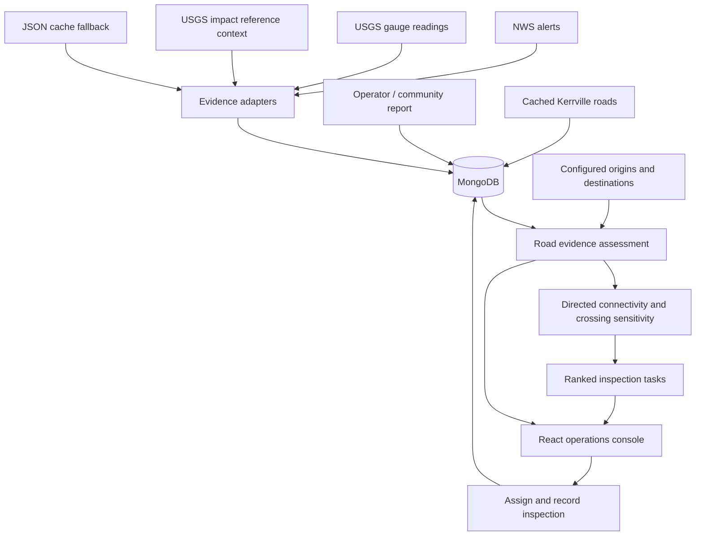

# Flood Watch / Lifeguard — State of the Union

**As of November 7, 2026, America/Chicago.**
**Integration branch: `feat/frontend`.**

This is the current technical and product handoff for the team. It distinguishes
implemented code, local verification, teammate-reported live behavior, and proposed
work. Read this before the older [handoff](HANDOFF.md), which describes the
driver-rescue track and contains historical branch instructions.

## 1. Executive summary

We have two related capabilities, with different sources of truth:

1. **Driver rescue demo:** synthetic driver movement and simulated road flooding
   trigger pre-trip warnings, en-route turn-around/rerouting, stopped-in-water
   escalation, outreach, a simulated drone flight, and precomputed vision results.
2. **Evidence-to-inspection workflow:** timestamped observations become road
   assessments; uncertain crossings are evaluated for their effect on neighborhood
   access; consequential gaps become inspection tasks; an operator-entered inspection
   result becomes new evidence and changes the map and queue.

The second workflow is the current implementation focus. It does **not yet drive**
the legacy driver simulator. There is no authorized State Farm telemetry integration,
physical drone integration, validated road-depth predictor, or Gemini integration.

The new workflow has a functioning MongoDB persistence layer, real geographic queries,
a React operations screen, a repeatable synthetic two-exit scenario, and automated
coverage of the feedback loop. This is a local hackathon milestone, not a deployed
emergency-response service or a declaration that a route is safe.

## 2. What changed during this session

### Starting point and scope

- Cloned the supplied `feat/frontend` branch at `c32b802` into the Lifeguard workspace.
- Read the README, API contract, vault, implementation, and frontend checkpoint notes.
- Found no SQL/Mongo database, connection configuration, or migrations in that initial
  checkout. Runtime state was in memory, with JSON town/feed caches and JSONL outreach logs.
- The original frontend primarily exposed the component gallery and placeholder navigation.
- The user clarified that evidence aggregation and drone verification should come first;
  Drive Safe & Save danger detection is a separate parallel product track for later.
- Three implementation agents worked on persistence/ingestion, analysis/API, and operations UI.
- The initial local database implementation was SQLite. The user then selected MongoDB;
  MongoDB is now the default, with SQLite retained as an explicit development/test option.

### Integration with teammate work

Before publishing, `origin/feat/frontend` had advanced to `bc15367`, bringing in newer
backend work, including Photon 2.0, ElevenLabs voice, privacy/origin checks, bridge
elevation corrections, and the image-processing pipeline. Those changes were merged,
not overwritten. The integrated lifespan retains inbound outreach startup/shutdown,
pending-call cleanup, simulation cleanup, evidence polling, and database cleanup.

The earlier chat assessment that vision generation was absent applied to `c32b802`.
The merged branch now contains `backend/vision/detect.py`, `assess.py`, and
`backend/scripts/run_vision_batch.py`. Their existence does not imply live drone ingestion.

## 3. Status by capability

| Capability | Current status | Evidence / boundary |
|---|---|---|
| Cached Kerrville road graph, river, elevation | Implemented | 4,234 directed segment features; legacy town/simulation tests run locally |
| NWS flood-warning ingestion | Implemented adapter and normalization | Fetches live with cache fallback; tests mock upstream responses |
| USGS gauge latest/history ingestion | Implemented | Preserves measurement time, source mode, units, and gauge-datum context |
| USGS flood-impact reference points | Implemented as context | Thresholds are not new flooding observations or closures |
| TxDOT / DriveTexas | Not connected | Source explicitly reports `not_configured`; no fabricated closure feed |
| Weather/rainfall feed | Planned | No dedicated normalized weather ingestion adapter in this milestone |
| Local/community reports | Implemented | Explicit road selection; stored as unverified, timestamped evidence |
| MongoDB persistence | Implemented and tested locally | Real single-node replica set; history, transactions, restart and geo tests |
| MongoDB Atlas | Configurable URI, not provisioned | No Atlas cluster or Atlas credentials created by this work |
| SQLite | Implemented alternative | Tests and offline development; no automatic fallback on Mongo connection failure |
| Road freshness/conflicts | Implemented | Unknown is distinct from open; source revisions/history preserved |
| Warning-to-road geographic linking | Implemented | Polygon intersection supplies hazard context, not a closure assertion |
| Neighborhood connectivity | Implemented first version | Directed optimistic/conservative connectivity to explicitly configured destinations |
| Inspection ranking | Implemented first version | Single-crossing loss-of-access sensitivity with explainable reasons |
| Drone mission feedback | Implemented as operator workflow | Assign task, enter result, persist evidence, recalculate state |
| Drone flight control / camera streaming | Not implemented | No autopilot SDK, telemetry channel, or physical flight performed |
| Measured road water depth | Manual input supported only | Numeric input is not proof of a calibrated sensor measurement |
| Operations console | Implemented at `/` and `/console` | SVG road map, report form, source status, queue, community access |
| Driver UI `/driver`, presentation `/present` | Still not implemented as full screens here | Those links fall through to the legacy index; do not use them as demo promises |
| Legacy driver rescue engine | Implemented | Simulated flooding, synthetic drivers, warnings, reroutes, escalation, mock outreach |
| Photon / ElevenLabs live behavior | Teammate-reported, not retested here | See historical handoff and experiments; this session forced mock mode for integration tests |
| YOLO image pipeline | Present from teammate merge | Precomputed sample detections; heuristic placement and manually labeled water level |
| Gemini image/report analysis | Proposed only | No Gemini SDK call, API key setup, evaluated prompt, or live result in this change |
| Drive Safe & Save | Proposed only | No program dataset or live API access established |
| Validated flood forecasting | Not implemented | The legacy spread function remains a labeled simulation |

## 4. Current architecture



The legacy simulation and outreach system runs beside this workflow in the same
FastAPI application. The existing `/ws` stream serves legacy simulation events.
The new operations console polls `/api/evidence/state` approximately every five
seconds and refreshes after mutations. New evidence events are **not yet integrated
into that WebSocket contract**.

## 5. Database and evidence contract

### Backend selection and location

`backend/evidence/factory.py` selects the backend:

- Default: `FLOODWATCH_DB_BACKEND=mongodb`.
- Default Mongo URI: `mongodb://127.0.0.1:27017/?replicaSet=floodwatch`.
- Default database: `floodwatch`.
- Explicit alternative: `FLOODWATCH_DB_BACKEND=sqlite` and optional `FLOODWATCH_DB_PATH`.
- Failure to connect to MongoDB fails startup; it does not silently switch databases.

MongoDB must support transactions: use a replica set, Atlas, or a supported sharded
deployment. An ordinary standalone server is rejected. The local helper starts a
single-node replica set, binds only to `127.0.0.1`, and uses a bounded 128 MB oplog
and 0.25 GB WiredTiger cache. It is a development setup, not a production deployment.

Windows local binaries and database files live under `%LOCALAPPDATA%/FloodWatch`,
outside the OneDrive repository. Installer archives, database files, `.env`, virtual
environments, and generated browser output are not committed.

### MongoDB collections

| Collection | Purpose |
|---|---|
| `sources` | Attribution, category, expected update cadence |
| `ingestion_runs` | Attempt time, fetch time, status, accepted/rejected counts in detail |
| `raw_records` | Preserved submitted/provider payloads with source-scoped content hash |
| `observations` | Append-only normalized records and revision lineage |
| `roads` | Indexed GeoJSON road geometry, stored separately from dataset metadata |
| `settings` | Schema version and active dataset metadata/origins/destinations |
| `inspection_tasks` | Queue state, priority reasons, outcomes, timestamps, result references |

Roads are separate documents so a growing road network is not forced into one
MongoDB document. Both observation and road geometry have `2dsphere` indexes.
Unique semantic/revision indexes help prevent duplicates and preserve lineage.

The observation contract includes:

| Field | Meaning |
|---|---|
| `id`, `source_id`, `source_record_id` | Internal identity and upstream identity |
| `observed_at` | When the source says the condition was observed; nullable when unknown |
| `ingested_at` | When this application stored the observation |
| `valid_until` | Explicit expiry, where supplied |
| `kind` | `closure`, `report`, `gauge`, `warning`, `weather`, or `drone` |
| `road_id`, `geometry` | Direct road association and optional GeoJSON geometry |
| `value`, `unit` | Measurement and explicit unit, where applicable |
| `access` | `open`, `closed`, `restricted`, or `unknown` |
| `quality` | `unverified`, `agency`, `sensor`, or `operator` |
| `source_mode`, `simulated` | Live/cache/manual/simulation provenance |
| `raw` | Supporting source payload or report/inspection details |
| `supersedes_id` | Previous revision of the same source record |

Time parsing requires timezone-aware timestamps; invalid/non-finite measurements
and out-of-range coordinates are rejected. Geometry validation currently checks
types and coordinates, not every GeoJSON topology rule. There is no calibrated
numerical confidence score in this version; `quality` is an evidence category.

### Deduplication and transactions

- Re-fetching the same semantic observation does not create a fresh observation.
- Retrieval metadata and source mode do not determine the semantic hash.
- A changed record preserves the old record and links the revision.
- The original observation timestamp is never replaced with the poll timestamp.
- Ingestion health distinguishes last attempt from last successful live fetch.
- Recording an inspection result and updating its task are transactional.
- Tests use UUID-named databases and remove only the database they created.
- No old database was reset or deleted; no old database existed in the starting checkout.

## 6. Source behavior and legacy data fixes

The existing feed clients still provide bounded HTTP requests and on-disk cache
fallback. The new normalizers ingest flood-related NWS alerts, gauge measurements,
and USGS reference context. Fetches run concurrently; blocking database writes run
off the async event loop. A failed source does not erase previously stored evidence.

Specific bug fixed: `feeds/usgs_ogc.py` could select a reading from its history
fallback while labeling it with the latest endpoint's source/fetch metadata.
It now reports the selected source and exposes series/latest endpoint metadata.
Tests cover fallback provenance, partial availability, and duplicate polls.

Coverage limitations:

- These are local Kerrville sources, not a statewide ingestion network.
- NWS warning polygons are contextual; some alerts have no polygon and cannot be
  spatially linked by the current code.
- Gauge records retain stage/units and station context; normalizers do not yet
  attach station geometry or a hydrologic reach model to every record.
- USGS impact points are reference thresholds, with unknown observation time.
- DriveTexas requires an approved key and verified schema before an adapter is built.
- No social-media scraping, automatic report geocoding, rainfall ingestion, or
  completeness guarantees are implemented.
- Raw gauge evidence is the normalized source measurement/context, not an archive
  of every byte of the upstream response. Full feed-response archival is future work.

## 7. How road assessment works

`backend/evidence/analysis.py` evaluates direct evidence separately from hazard context.

1. Resolve source revisions and latest road evidence using actual parsed times.
2. Group road directions by physical crossing ID for assessment and inspection.
3. Evaluate freshness and explicit expiry.
4. Preserve conflicting claims and supporting observation IDs.
5. Retain agency closures until superseded or explicitly expired.
6. Accept current trusted open evidence only when the closure/conflict rules allow it.
7. Keep unverified open reports as unknown; warning/gauge context does not establish access.

Current direct-evidence freshness defaults are 30 minutes for closures, 15 minutes
for reports, and 10 minutes for drone results, unless explicit validity applies.
These are configuration-in-code heuristics, not scientifically calibrated freshness
limits. They do not yet shorten automatically with rising water.

`access`, `freshness`, and `agreement` are distinct dimensions. A road can be closed
with stale evidence; a fresh report can still conflict with an agency closure.
A fresh image alone does not certify passability.

## 8. Connectivity and inspection priority

Real-town connectivity requires explicit community origins and destinations. The
default town dataset has neither, so unknown roads alone do not generate thousands
of speculative tasks. Configure graph node IDs through `/api/evidence/configuration`.

For configured neighborhoods:

- **Optimistic connectivity:** uncertain/restricted roads may be usable; closed roads are excluded.
- **Conservative connectivity:** only open, nonconflicting roads are usable.
- **Remaining modeled exits:** outgoing physical crossings that can reach a destination
  without first returning through the origin; this is not a count of independent safe routes.
- **Inspection sensitivity:** remove one uncertain physical crossing and ask which
  currently optimistic neighborhoods lose all modeled access.

Only consequential single-crossing gaps enter the queue. The current heuristic score is:

```text
1000 × affected neighborhoods
+ min(affected households, 500)
+ 80 if conflicting
+ (40 if missing, 30 if stale, otherwise 10)
+ 20 if intersecting current warning context
```

This score is a ranking heuristic, not a probability or expected lives-saved metric.
It does not yet account for flood velocity, road capacity, evacuation demand,
travel-time penalties, combinations of crossing failures, flight feasibility,
battery, fleet allocation, or calibrated expected information gain.

On the full road graph, the current repeated reachability calculations need
profiling and optimization before many origins/candidates are configured. It is
intended to prove the bounded workflow, not statewide throughput.

## 9. Inspection lifecycle and the repeatable demo

Current persisted lifecycle: `queued` → `assigned` → `completed` or `inconclusive`.
An inconclusive task can be reassigned. Submitting a completion without assignment,
or repeating a completed submission, returns a conflict rather than inserting a duplicate.
The richer planned launching/en-route/inspecting/failed mission lifecycle is not built yet.

The two-exit demo is explicitly synthetic and geolocated near Kerrville:

1. A synthetic agency closure blocks the west crossing.
2. The east crossing's direct open report is 38 minutes old.
3. The Riverbank neighborhood's modeled access depends on the uncertain east crossing.
4. The east crossing becomes the one consequential inspection task.
5. Another stale crossing has an alternative route and is excluded from the queue.
6. Assign east, then record `closed`, `open`, or `inconclusive` with capture time,
   optional image reference, and optional manually entered depth.
7. The new observation changes assessment/connectivity and completes or retains the task.
8. Reloading or restarting preserves the result.

For the closed outcome, Riverbank becomes disconnected under both assumptions.
There is no manufactured next high-priority task: if no other consequential gap
exists in this scenario, the queue correctly becomes empty of active tasks.

Starting a new demo creates a scoped run ID and retains historical evidence.
`/api/evidence/town` returns to real cached roads without deleting demo history.
The legacy `/api/demo/start|reset` controls the driver simulation and does not reset
the evidence workflow. These are deliberately separate controls today.

## 10. API inventory

The existing [API contract](api-contract.md) documents the legacy rescue stream.
New evidence endpoints are listed here; `backend/evidence/routes.py` and the
running `/docs` page are the exact request-schema references.

| Method | Path | Purpose |
|---|---|---|
| GET | `/api/evidence/state` | Observations, roads, tasks, communities, sources, dataset metadata, generated time |
| GET | `/api/evidence/health` | Persistence diagnostics and geographic-index health |
| POST | `/api/evidence/ingest` | Fetch current feeds; returns ingestion summary and resulting state |
| POST | `/api/evidence/reports` | Unverified local report for an active-dataset road |
| POST | `/api/evidence/demo` | Start a new synthetic two-exit evidence exercise |
| POST | `/api/evidence/town` | Restore cached Kerrville roads as active dataset |
| POST | `/api/evidence/configuration` | Set community/destination graph nodes |
| POST | `/api/evidence/tasks/{id}/assign` | Assign a queued/inconclusive task |
| POST | `/api/evidence/tasks/{id}/complete` | Record operator inspection result and recompute state |
| GET | `/api/evidence/nearby?lon=...&lat=...&radius_m=...` | MongoDB spherical observation query |
| POST | `/api/evidence/intersections` | MongoDB road/GeoJSON intersection query |

The state endpoint returns full collections rather than paginated deltas. Nearby
queries are capped at 500 results, road intersections at 1,000; pagination and
explicit truncation metadata are future improvements. SQLite returns 501 for
Mongo-specific geographic query endpoints.

Example report:

```json
{"road_id":"demo-east","observed_at":"2026-11-08T02:00:00Z","access":"closed","raw":{"description":"Water visibly covers the crossing"}}
```

Example inspection result (use the actual capture time):

```json
{"outcome":"closed","observed_at":"2026-11-08T02:00:00Z","image_url":"/static/drone/flood_03.jpg","water_depth_in":14.5}
```

Road reports cannot elevate themselves to agency/sensor quality. Depth above is
operator-submitted evidence, not an automatic visual measurement.

## 11. Flood-level detection: decided boundaries and proposed next work

We have **not selected or integrated a validated flood-depth model**.

There are three different questions:

1. **River stage:** what does a gauge measure at its station and datum?
2. **Inundation/depth:** where does water spread, and how high is it relative to terrain/road deck?
3. **Visible condition:** does imagery show water, blockage, vehicles, or people at a crossing?

Existing candidates discussed:

| Product/model | Appropriate role | Integration status |
|---|---|---|
| NOAA National Water Model | River-reach streamflow guidance | Researched, not connected |
| NOAA inundation mapping / HAND | Reach/terrain-based inundation estimates | Researched; Kerrville availability still to verify |
| USGS inundation-map libraries | Gauge-stage-linked mapped scenarios where covered | Researched; local library coverage still to verify |
| HEC-RAS | Locally configured hydraulic water-surface/depth/velocity modeling | No local model, calibration, or import implemented |
| FloodNet-trained segmentation | Candidate flood/road masks from UAV imagery | Dataset/model research only; no checkpoint integrated |
| Gemini vision | Candidate structured visual observations and scene explanation | Proposed; no evaluated API integration |

The legacy simulator raises water at a scripted rate, applies a distance-to-river
spread heuristic, then subtracts road elevation. It has demo calibration, not
hydraulic validation. Bridge approach-elevation fixes improve the demo but do not
turn it into a surveyed bridge-deck model.

A valid local depth estimate requires compatible vertical references and a
defensible water-surface estimate at that location:

```text
depth over road = max(0, local water-surface elevation − road/deck elevation)
```

The equation alone is not a hydraulic model. Gauge height must first be interpreted
with its datum and spatial applicability. A normal drone photograph generally
supports water coverage observations, not precise absolute depth without calibrated
references, suitable geometry, or an independent sensor. None of these methods
alone certifies safe driving conditions.

Proposed next model milestone: choose one real crossing; verify official product
coverage, gauge/reach linkage, terrain/deck data and datum; import one existing
model result as separately labeled evidence; compare it with timestamped ground
truth; add an inconclusive path and quantify error before broadening coverage.

References reviewed:
- [NOAA National Water Model](https://water.noaa.gov/about/nwm)
- [NOAA inundation method](https://www.nesdis.noaa.gov/events/implementation-of-forecast-flood-inundation-mapping-services-the-nation)
- [USGS inundation mapper](https://apps.usgs.gov/fim/)
- [USGS gauge height explanation](https://waterdata.usgs.gov/blog/gage_height/)
- [HEC-RAS features](https://www.hec.usace.army.mil/software/hec-ras/features.aspx)
- [FloodNet UAV dataset](https://github.com/BinaLab/FloodNet-Supervised_v1.0)
- [Gemini image understanding](https://ai.google.dev/gemini-api/docs/image-understanding)

## 12. Run the integrated milestone

### Windows / PowerShell

From the repository root, with Python and Node.js installed:

```powershell
python -m pip install uv
cd backend
python -m uv sync --python 3.12
cd ..
powershell -NoProfile -File scripts/start-mongodb.ps1
```

The script downloads the official MongoDB Community 8.0 Windows distribution,
verifies SHA-256, extracts the needed server/license files, and initializes only
the `floodwatch` replica set. An unrelated existing replica set on the port is
not reconfigured. Allow disk headroom for binaries, journal, data, and dependencies.

Backend terminal:

```powershell
$env:PHOTON_MODE = 'mock'
$env:EVIDENCE_POLL_SECONDS = '0' # manual refresh for a deterministic offline exercise
cd backend
python -m uv run uvicorn app.main:app --host 127.0.0.1 --port 8000
```

Frontend terminal:

```powershell
cd frontend
npm.cmd ci
npm.cmd run dev -- --host 127.0.0.1
```

Open `http://localhost:5173/console`. Click **Load two-exit demo**, select/assign the
east crossing, record a simulated inspection, and inspect the changed access state.
The Vite proxy forwards API requests to port 8000. Set `VITE_BACKEND_URL` when using
a different backend address. `/api/evidence/health` must report a healthy Mongo backend.

For automatic source polling, use `EVIDENCE_POLL_SECONDS=120` (default). Values are
0 or at least 30 seconds. Polling is independent of the accelerated simulation clock.
The console's **Refresh sources** button can still fetch when automatic polling is off.

VS Code tasks: **Flood Watch: start all** starts MongoDB/backend/frontend dependencies;
**ECC: audit harness** runs the bundled audit; **ECC: parallel reviews** needs Claude login.
These startup helpers are Windows-specific; the Python application itself is not.

### Atlas or another Mongo replica set

Set `MONGODB_URI` and `MONGODB_DATABASE` privately in the environment or `.env`.
Do not commit the URI if it contains credentials. Configure Atlas access/users
through the team's account; no cloud resources have been provisioned here.
Do not run the local MongoDB helper when intentionally using Atlas.

### Explicit SQLite mode

Set `FLOODWATCH_DB_BACKEND=sqlite` before starting the backend. This is useful for
offline evaluation and tests; it does not provide MongoDB's native geo queries.
There is no automatic SQLite-to-Mongo migration tool in this milestone. Existing
SQLite evidence, if any, is left untouched when selecting MongoDB.

### Optional development tools

Core `uv sync` excludes the large vision training/inference and town-building stack.
Install `uv sync --extra vision` to rerun image inference, or `--extra data-build`
to rebuild terrain caches. The committed town and vision results support the
existing demo without downloading model weights or installing those extras.

## 13. Verification performed for this integration

| Check | Result | What it proves / does not prove |
|---|---|---|
| Backend pytest with real `MONGODB_TEST_URI` | **373 passed** | Combined legacy+evidence tests, including all real Mongo tests |
| Evidence-module coverage | **94% statements** | New evidence package only; not whole-repo coverage |
| Real Mongo history/dedup/restart | Passed | Actual local replica set, not a Mongo mock |
| Real Mongo rollback | Passed | Failed mission transaction leaves no partial observation/task/raw record |
| Real `2dsphere` nearby/intersection queries | Passed | Database geographic indexes exercised with test geometries |
| Full FastAPI lifespan + Mongo inspection + restart | Passed | Real cached town loads; demo result persists across app restarts |
| Untrusted-origin evidence mutation | Rejected in integration test | Preserves teammate origin-guard convention; not user authentication |
| Frontend Vitest | **78 passed** | UI/state behavior with fixtures |
| Frontend production build | Passed | TypeScript + Vite compilation; bundle-size advisory remains |
| Playwright evidence workflow | **2 passed** | Mocked API: assign/complete/reload/mobile width and honest service failure |
| Targeted Ruff evidence/main checks | Passed | Modified Python checks; not a full repository lint claim |
| ECC deterministic harness audit | Runs; **18/39** on initial snapshot | Infrastructure-readiness score, not application correctness or security certification |

Backend run command:

```powershell
cd backend
$env:MONGODB_TEST_URI = 'mongodb://127.0.0.1:27017/?replicaSet=floodwatch'
python -m uv run pytest -q --cov=evidence --cov-report=term-missing
```

Without `MONGODB_TEST_URI`, five real-Mongo/app integration tests intentionally skip.
Tests never require real outreach credentials and should not send texts/calls.

Browser check:

```powershell
cd frontend
$env:PLAYWRIGHT_CHANNEL = 'chrome'
npm.cmd run e2e -- evidence.spec.ts
```

System Chrome was used after the bundled Chromium download failed. The browser
workflow uses a mocked API; the separate Python full-app integration uses real MongoDB.
An all-live browser-to-FastAPI-to-Mongo exercise remains an additional final-demo check.

Known test caveats: existing Shapely and Starlette deprecation warnings remain.
Two teammate tests assumed POSIX `0600` bits; their file-content checks still run
on Windows, while the POSIX bit assertions now run only on non-Windows platforms.
Windows ACL privacy is not established by those tests.

## 14. Harness, reviews, and parallel work

The repository includes ECC under `.claude/`. Agent instructions used during this
work included database/Python/FastAPI review and React/accessibility review criteria.
Native Codex agents executed the implementation with disjoint file ownership.

The Claude CLI is installed but was not signed in. No Claude-hosted parallel agent
execution is claimed. `scripts/review-harness.ps1` checks authentication and, after
the user signs in, launches the repository's `database-reviewer`, `fastapi-reviewer`,
and `code-reviewer` concurrently with read-only tools and separate ignored logs.

The missing `@iarna/toml` dependency for ECC's audit was added under `.claude/`.
Run `npm ci --prefix .claude`, then `npm run audit --prefix .claude`.
The audit's outstanding plugin/CI/readiness findings were not disguised as passing.

Some targeted database bugs have recorded RED/GREEN evidence. Initial module
implementation preceded the harness clarification, so we do not claim every new
line was produced through a complete test-first/commit-checkpoint process.

## 15. Security, operational limits, and unresolved issues

- Origin checks are not authentication. There are no user roles, mission approval
  permissions, rate limits, or production authorization boundaries in the evidence API.
- Local MongoDB is loopback-only without credentials; configure proper credentials,
  transport, and access controls before any shared/cloud deployment.
- Report and inspection input is operator-supplied; it is not independently verified.
- Image URLs are references only. There is no media upload pipeline, camera authenticity
  check, image georegistration, retention policy, or sensor-calibration registry yet.
- `quality` categories and ranking weights are heuristic. Inconclusive handling is
  implemented; calibrated uncertainty and measurement error are not.
- Road/observation state responses are unbounded full snapshots; ingestion history
  and historical runs need retention/pagination before sustained use.
- Community origins/destinations must be configured. There is no UI for choosing
  these yet, no safe-destination certification, and no validated population coverage.
- The inspection analysis evaluates individual crossing failures, not joint cuts.
- A strong agency closure can persist without an explicit expiry until superseded;
  this is conservative evidence handling, not a guarantee the source remains current.
- A new inspection may conflict with other evidence. It does not override every
  source simply because it is newer.
- Background polling and manual refresh are not yet coalesced across concurrent
  callers. Single-process local use is the tested deployment shape.
- Evidence writes and legacy simulator state remain separate; restarting preserves
  evidence but resets legacy in-memory simulation state.
- No remote production service, Atlas instance, external AI call, hardware flight,
  actual State Farm telemetry, or statewide flood coverage was validated here.

## 16. Recommended next work and ownership boundaries

### Milestone A — Team demo acceptance

1. Everyone pulls `feat/frontend` and runs MongoDB/backend/frontend using this guide.
2. Run the synthetic exercise in a real browser against the live backend.
3. Record an open outcome, a closed outcome, and an inconclusive outcome.
4. Verify reload/restart persistence and photograph the source/observation timestamps.
5. Choose the presentation emphasis: evidence verification first, legacy driver rescue second.

### Milestone B — One real crossing with meaningful observations

1. Select a real neighborhood, crossing, and destination with explicit graph IDs.
2. Obtain an approved closure source or enter attributed operator reports.
3. Verify road matching, physical crossing grouping, directionality, and destination assumptions.
4. Ingest a geolocated, timestamped inspection with a documented measurement method.
5. Demonstrate changed analysis without claiming a safe route from imagery alone.

### Milestone C — Camera and flood-model integration

1. Choose a vision path: evaluated Gemini extraction or an appropriate trained segmentation model.
2. Define outputs such as water-visible, road-overlap mask, obstruction, people/vehicles,
   image quality, and unable-to-assess. Avoid fake numeric depth from ordinary RGB imagery.
3. Save model name/version, prompt/configuration, capture metadata, review state, and outputs.
4. Evaluate against held-out labeled frames, including glare, shadows, vegetation,
   obscured roads, and negative examples. Report failure cases.
5. Independently verify a local official inundation product or hydraulic model;
   preserve forecast issue time, valid time, datum, resolution, and uncertainty.

### Milestone D — Shared cloud demo

Connect to a team-owned Atlas database, add media storage and controlled access,
then deploy backend/frontend. MongoDB Atlas is a strong sponsor fit; local MongoDB
alone is not Atlas usage. Gemini is a natural optional sponsor fit after a real,
evaluated API feature exists. Tiger Data, Solana, Vultr, Terraform, Cloudflare,
and DEV were discussed as options, not implemented integrations or confirmed prize eligibility.

### Separate driver-safety work

Drive Safe & Save remains dependent on an authorized dataset/integration and clear
data handling. Until then, continue explicitly synthetic telemetry. Do not present
the current drivers as State Farm customer data.

## 17. Code map

| Area | Main files |
|---|---|
| Input validation | `backend/evidence/models.py` |
| Backend selection | `backend/evidence/factory.py` |
| Mongo persistence/geographic queries | `backend/evidence/mongo_store.py` |
| SQLite persistence/migrations | `backend/evidence/store.py` |
| Feed normalization | `backend/evidence/ingestion.py`, `backend/feeds/` |
| Road assessment and connectivity | `backend/evidence/analysis.py` |
| Dataset/task orchestration | `backend/evidence/service.py` |
| Synthetic two-exit fixtures | `backend/evidence/demo.py` |
| REST endpoints | `backend/evidence/routes.py` |
| Lifespan, polling, merged cleanup | `backend/app/main.py` |
| Operations screen | `frontend/src/evidence/Operations.tsx`, CSS module, `types.ts` |
| Backend tests | `backend/tests/test_evidence_*.py` |
| Browser workflow | `frontend/e2e/evidence.spec.ts` |
| Local Mongo setup | `scripts/start-mongodb.ps1`, `scripts/init-mongodb.py` |
| Optional Claude reviews | `scripts/review-harness.ps1`, `.claude/agents/` |
| Legacy driver logic | `backend/stages/`, `backend/sim/`, `backend/scoring/` |
| Teammate outreach/vision | `backend/outreach/`, `backend/vision/`, `docs/voice-agent.md` |

This handoff supersedes earlier status claims when they conflict. Test results
describe the integrated local checkout at publication; they are not evidence of
a deployed service, real flight, live customer-data access, or validated flood prediction.
