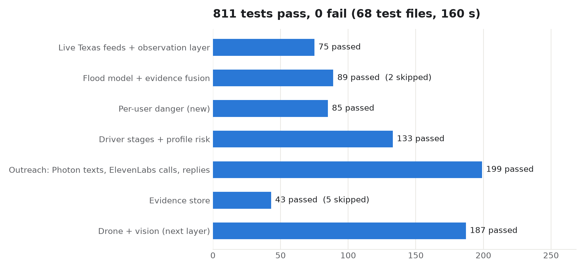
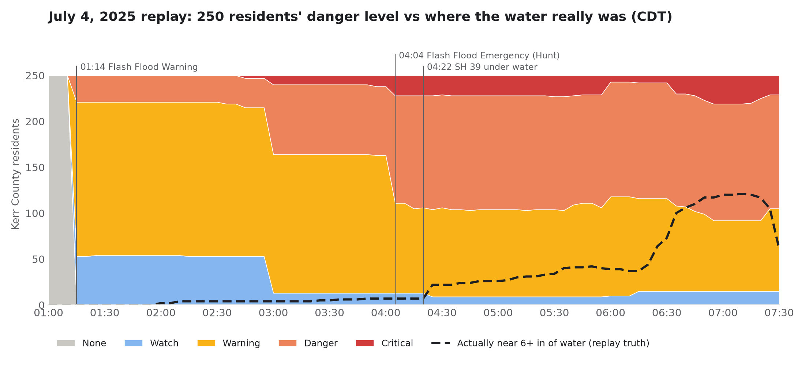
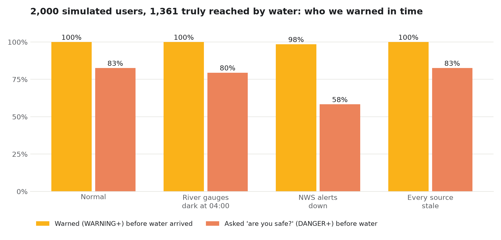

# Test evidence: per-user flood danger (feat/safety-core)

Presentation copy (interactive): https://claude.ai/artifact/HAjyBQR6k1YhaLcL54Ps4w. It is private until it's shared from the page's Share menu.
Slide-ready figures are in [`docs/test-evidence/`](test-evidence/). Raw data is in `data/experiments/`.

## 1. The suite: 811 passed, 0 failed, 7 skipped

Run of 2026-11-08 02:54 CT: 68 test files, 160 s, `uv run pytest -q`.



| Layer | Passed | Skipped |
|---|---:|---:|
| Live Texas feeds + observation layer | 75 | 0 |
| Flood model + evidence fusion | 89 | 2 |
| **Per-user danger (new)** | **85** | 0 |
| Driver stages + profile risk | 133 | 0 |
| Outreach: Photon texts, ElevenLabs calls, replies | 199 | 0 |
| Evidence store | 43 | 5 |
| Drone + vision (next layer) | 187 | 0 |

Skipped tests:
- `test_evidence_mongo` and `test_evidence_app` need a running MongoDB replica set.
- `test_replay_golden` is the bit-for-bit replay digest (`RUN_SLOW=1`, about 15 min).

### Sixteen guarantees, each pinned to a test (all passing)

| Guarantee | Test |
|---|---|
| Unknown water depth is never read as a dry road | `test_safety_hazard::test_unknown_depth_is_not_dry_and_not_flooded` |
| Deeper water never lowers the danger level | `test_safety_hazard::test_monotone_in_depth` |
| Your own car's stall depth sets the critical line | `test_safety_hazard::test_depth_on_your_road_uses_your_stall_depth` |
| An NWS outage never reads as all-clear | `test_safety_hazard::test_nws_outage_does_not_read_as_all_clear` |
| A car stopped in water is CRITICAL | `test_safety_region::test_stopped_in_water_is_critical` |
| Vulnerability raises a level but never invents one | `test_safety_region::test_vulnerability_bumps_but_never_invents` |
| Water ahead while driving means turn around | `test_safety_region::test_water_ahead_while_driving` |
| No reply: poll, then call, then family | `test_safety_policy::test_danger_poll_then_call_then_family` |
| Never the same alert twice inside a cooldown | `test_safety_policy::test_never_duplicates_same_level_within_cooldown` |
| HELP flags responders and beats a later SAFE | `test_safety_policy::test_help_flags_responders_once_and_beats_a_later_safe` |
| Users with hearing loss are never called | `test_safety_policy::test_no_voice_users_are_never_called` |
| No all-clear after HELP, an open case, or dark evidence | `test_safety_policy::test_no_all_clear_after_help_or_with_an_open_case` |
| GPS jitter at home never looks like driving | `test_safety_motion::test_gps_jitter_while_parked_never_drives_or_walks` |
| Real numbers are never texted unless allowlisted | `test_outreach_guard::test_real_number_never_sent_even_in_photon_mode` |
| Phone numbers never appear in API responses | `test_safety_api::test_enroll_validates_and_never_echoes_phone` |
| July 4, 2025: Ruth is at DANGER before SH 39 floods | `test_safety_region::test_replay_finds_ruth_in_danger_before_the_emergency` |

## 2. The July 4, 2025 replay

The replay runs 250 simulated Kerr County residents through the pipeline (`scripts/safety_timeline.py`).



- **Colors** show what the system believed. It sees only the evidence a live deployment would have: gauges, NWS alerts, radar, storm reports and drones.
- **The dashed line** is the replay's truth, which the system never sees: residents with 6 in or more of water within 150 m.
- **Timing:** everyone is at WARNING or above minutes after the real 01:14 Flash Flood Warning. The truth line only starts climbing after 04:00.
- **Ruth**, 78, lives in Hunt beside the SH 39 crossing and uses a mobility aid. Her timeline:
  - 01:15: voice call.
  - 01:20: emergency contact reached.
  - 03:55: case opened.
  - SH 39 went under water at 04:22.

## 3. Stress test: 2,000 users, scored against truth, with data-source failures

Command: `scripts/stress_safety.py --users 2000 --fault <none|usgs_dark|nws_down|stale>`

The population is 615 users at crossings, 985 at home and 400 driving. Replies are simulated per user: 60% answer safe, 10% ask for help, 30% stay silent. 1,361 users were truly reached by water.



| Scenario | Warned in time | Median lead | DANGER in time | Median lead | False alarms | Messages per person (median / p95) |
|---|---:|---:|---:|---:|---:|---:|
| Normal | 100% | 210 min | 82.6% | 110 min | 9.9% | 6 / 11 |
| River gauges dark at 04:00 | 100% | 210 min | 79.5% | 117 min | 10.2% | 6 / 10 |
| NWS alerts down | 98.5% | 136 min | 58.3% | 118 min | 9.3% | 3 / 9 |
| Every source stale | 100% | 210 min | 82.6% | 110 min | 9.9% | 6 / 11 |

- **The NWS outage exposed a bug.** Before the fix, 1,092 users fell to "none": warning recall was 56% and DANGER recall 25%. When alerts are unavailable, rising gauges or heavy rain now stand in for a warning.
- **Stale sources** keep the same levels, but every assessment is labelled low confidence.

## 4. Speed

| Measure | Result |
|---|---|
| Location ping (median) | 0.7 ms, about 1,000 per second on one thread |
| Re-check 2,000 people per flood update | 0.43 s |
| Re-check 5,000 people all driving | 2.6 s (the live cycle is 30 s) |
| 20,000 all driving | 11 s (needs vectorizing or sharding) |

## Regenerate everything

```bash
cd backend
uv run pytest -q --junitxml=/tmp/junit.xml
uv run python scripts/safety_timeline.py
for f in none usgs_dark nws_down stale; do uv run python scripts/stress_safety.py --users 2000 --fault $f; done
uv run python scripts/stress_safety.py --load 5000
uv run python scripts/safety_figures.py --junit /tmp/junit.xml   # -> test_inventory.json + docs/test-evidence/*.png
```
