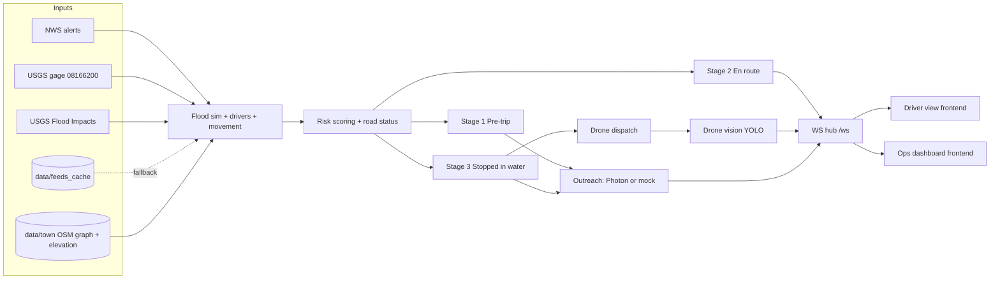

# Architecture

Feeds and the offline sim feed one scoring core. Scoring drives three stages. Stages call outreach (Photon or mock) and the drone, and everything streams to the frontend through one WebSocket hub.

## Data flow

1. **Feeds** (`backend/feeds/`) fetch NWS, USGS gage, and USGS Flood Impacts with a 5 s timeout. On failure they fall back to `data/feeds_cache/` and tag the response `source: cached`.
2. **Sim** (`backend/sim/`) loads the offline town (`data/town/`), computes river water surface and depth per segment, and moves drivers along their usual routes each tick.
3. **Scoring** (`backend/scoring/`) turns depth, rate of rise, night, age, vehicle, and situation into an urgency score with `reasons[]`. Road status comes from the NWS thresholds.
4. **Stages** (`backend/stages/`) run the three stages as described in [[Stage 1 Pre-trip]], [[Stage 2 En route]], and [[Stage 3 Stopped in water]].
5. **Outreach** (`backend/outreach/`) sends texts, polls, and voice calls through the Photon or ElevenLabs adapter, or logs them in mock mode. Every attempt goes to `data/outreach_log.jsonl`.
6. **Drone** (`backend/drone/`, `backend/vision/`) flies to the stopped car and attaches a vision result.
7. **WS hub** (`backend/api/ws.py`) broadcasts `segments.update`, `drivers.update`, `alert`, `outreach`, `case.update`, `drone.update`, and `counters`.

## Stack

- Backend: Python 3.12 via `uv`, FastAPI, WebSockets, networkx, osmnx, py3dep, numpy, shapely, pydantic. See `backend/pyproject.toml`.
- Vision: ultralytics YOLOv8n, run offline ahead of time.
- Frontend: React + Vite + TypeScript (`frontend/`, teammates). See [[Dashboard]].
- Outreach: Photon Spectrum (Stable), ElevenLabs Conversational AI. See [[Photon Outreach]].

## Key files

- `backend/app/main.py` (exists): FastAPI app, CORS, routers, WS hub
- `backend/api/schemas.py` (exists): Pydantic models for the API contract
- `docs/api-contract.md` (exists): what the frontend reads. Status line lists which endpoints are live.
- `backend/config/weights.yaml`: all tunables

## Related

- [[Decisions]] for why Photon, Python 3.12, and mock mode
- [[Data Sources]] for each feed's URL and auth
- [[Tooling]] for the ECC setup
